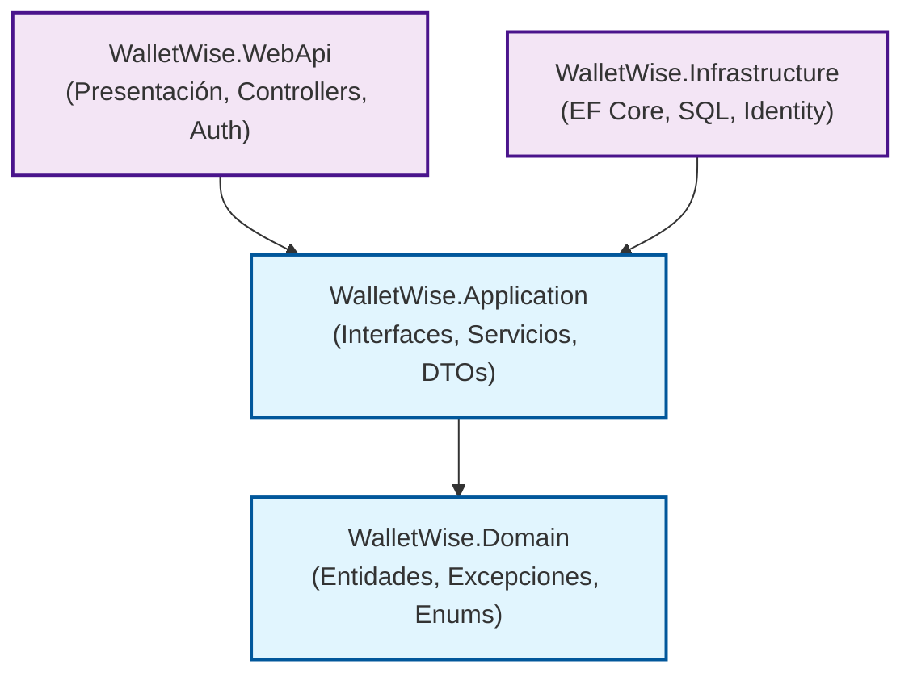

# 📈 WalletWise API

WalletWise es una API RESTful integral para la gestión de finanzas personales, construida con **.NET 9**. Proporciona a los usuarios las herramientas necesarias para registrar gastos, administrar presupuestos estrictos, analizar hábitos financieros mediante reportes y mantener el control sobre múltiples billeteras. 

Está diseñada como un proyecto de portafolio para demostrar buenas prácticas de desarrollo backend, siguiendo los principios de la **Arquitectura Limpia (Clean Architecture)** e implementando características robustas de seguridad y rendimiento.

---

## 🚀 Funcionalidades Principales

*   **🔒 Autenticación y Seguridad:** Registro e inicio de sesión seguros con ASP.NET Core Identity. Implementa autenticación mediante **JWT**, rotación con *Refresh Tokens* y limitación de peticiones (*Rate Limiting*) por IP y usuario para prevenir abusos.
*   **💼 Gestión de Billeteras (Wallets):** Soporte para múltiples billeteras simultáneas para separar fondos (ej. Efectivo, Tarjeta de Crédito, Ahorros).
*   **📊 Control de Transacciones y Categorías:** Registro de ingresos y gastos categorizados. Los endpoints soportan filtrado y paginación para un manejo eficiente de grandes volúmenes de datos.
*   **🛡️ Control de Presupuestos (Modo Estricto):** Permite establecer límites de gasto por categoría y periodo. El "Modo Estricto" intercepta y rechaza automáticamente transacciones que superarían el presupuesto definido.
*   **📈 Reportes Financieros:** Generación de métricas analíticas (resúmenes globales, tendencias mensuales, top de gastos, comparativas entre periodos) y exportación de datos a JSON.

---

## 🛠️ Stack Tecnológico y Prácticas

| Capa | Tecnología |
| :--- | :--- |
| **Framework** | .NET 9.0 (ASP.NET Core Web API), C# 13 |
| **Base de Datos** | Microsoft SQL Server 2022 |
| **ORM** | Entity Framework Core 9.0 |
| **Seguridad** | ASP.NET Core Identity, Autenticación JWT Bearer |
| **Pruebas** | xUnit, Moq, **Testcontainers** (Integración) |
| **Infraestructura** | Docker y Docker Compose |

### 🧠 Patrones y Buenas Prácticas Implementadas
*   **Clean Architecture:** Separación de responsabilidades con un Dominio agnóstico.
*   **Patrón Repositorio:** Abstracción del acceso a datos centralizada.
*   **Inyección de Dependencias (DI):** Gestión del ciclo de vida de los servicios de forma desacoplada.
*   **Manejo Global de Excepciones:** Respuestas HTTP consistentes (`ApiErrorResponse`) sin ensuciar los controladores mediante `IExceptionHandler`.
*   **Rate Limiting Avanzado:** Políticas de límite de concurrencia para reportes pesados y límite de ventana fija/deslizante para autenticación y operaciones CRUD.
*   **Mapeo de Objetos:** Aislamiento de las entidades de dominio hacia el cliente usando DTOs y AutoMapper.

---

## 🏗️ Arquitectura de la Solución

El proyecto está estructurado para que el núcleo de la aplicación (Domain) no dependa de ningún framework externo de infraestructura, facilitando el mantenimiento y las pruebas:



---

## ⚙️ Requisitos y Ejecución Local

### Prerrequisitos
*   [SDK de .NET 9.0](https://dotnet.microsoft.com/download/dotnet/9.0)
*   [Docker](https://www.docker.com/) (Recomendado para levantar la base de datos fácilmente)

### 1. Variables de Entorno
Crea un archivo `.env` en la raíz del repositorio para que Docker Compose configure la contraseña del servidor SQL.
```env
DB_PASSWORD=TuContrasenaSegura123!
```
*Nota: Asegúrate de que la contraseña cumpla con las políticas de complejidad de SQL Server (mayúsculas, minúsculas, números, símbolos).*

### 2. Levantar la Base de Datos
Desde la raíz del proyecto, ejecuta el contenedor de SQL Server:
```bash
docker-compose up -d db
```
*El servidor estará mapeado al puerto `1435` en tu máquina local.*

### 3. Ejecutar la API
Navega al proyecto de presentación e inicia el servidor. Al estar en el entorno de desarrollo (`Development`), **la aplicación aplicará automáticamente las migraciones** de la base de datos (tanto de la app como de Identity) al arrancar.
```bash
cd WalletWise.WebApi
dotnet run
```

---

## 📡 Documentación de la API (Swagger)

Con la API en ejecución, navega en tu navegador a:
👉 `http://localhost:5050/swagger` *(O el puerto en el que se haya levantado tu app, como `5000`)*.

El panel de Swagger interactivo agrupa los endpoints por módulos:
1.  **Autentícate:** Usa `POST /api/auth/login` con tus credenciales para obtener un JWT.
2.  **Autorización Global:** Haz clic en el candado o en el botón *Authorize* arriba a la derecha y pega tu token.
3.  **Explora:** Prueba la creación de Wallets (`/api/wallets`), agrega transacciones (`/api/transactions`) y revisa tus presupuestos (`/api/budgets`).

---

## 🧪 Pruebas Automatizadas

El proyecto incluye una suite de pruebas exhaustiva para garantizar su estabilidad:
*   **Pruebas Unitarias:** Validan la lógica de negocio compleja en la capa de servicios (como la validación del "Modo Estricto" de los presupuestos) simulando dependencias con `Moq`.
*   **Pruebas de Integración:** Utilizan **Testcontainers** para levantar de forma completamente transparente y efímera un contenedor de SQL Server. Esto permite probar los repositorios, la base de datos y los endpoints de la API en un entorno real antes de ser destruido.

Para ejecutar todas las pruebas de la solución:
```bash
dotnet test
```
